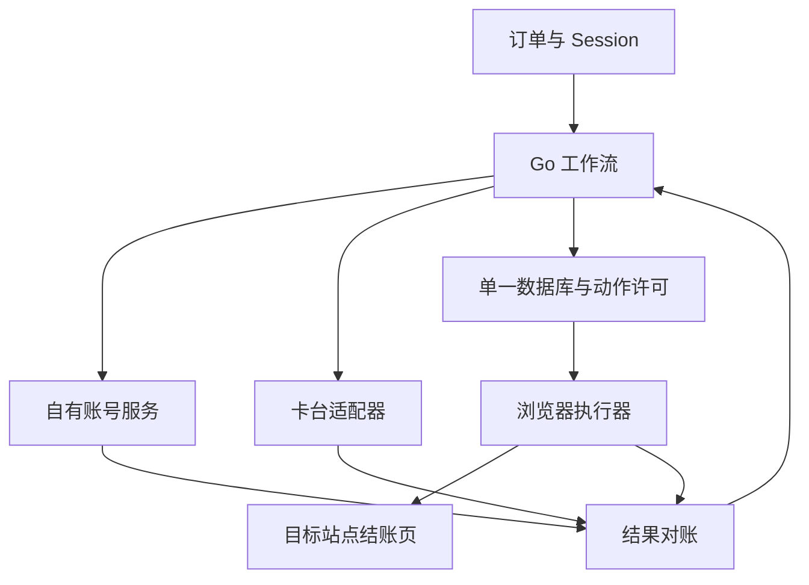

# 自有账号与付款执行引擎：实现与验收

研究日期：2026-11-13。基线：`varrge/kwMembership@16ceb97fc15f629c8b59df242e1baee2227e4c77`。

目标是由自有服务负责账号操作、创建结账、填表、付款提交和结果确认；外部卡台负责卡片与资金能力。本分支已完成可独立运行的无付款预检入口、按卡绑定账单资料、服务接口解耦和执行修复，**尚未完成完整 worker 的独立生产启动、真实账号查询/取消续费适配器或真实付款验收**。默认 `cmd/membership-worker` 仍使用兼容构造器；新增构造器需要在自有付款启动入口显式接线。

## 1. 保存的源码

| 用途 | 上游 | 自有 fork |
| --- | --- | --- |
| 主要支付执行参考 | [varrge/kwMembership](https://github.com/varrge/kwMembership) | [7yedeng/kwMembership](https://github.com/7yedeng/kwMembership) |
| 官方订单/CDK 与卡台协议参考 | [zovocard/zovo_card_cdk_auto](https://github.com/zovocard/zovo_card_cdk_auto) | [7yedeng/zovo_card_cdk_auto](https://github.com/7yedeng/zovo_card_cdk_auto) |
| 官方代码相关副本、差异参考 | [PIPIWANGLUO/PPCDK](https://github.com/PIPIWANGLUO/PPCDK) | [7yedeng/PPCDK](https://github.com/7yedeng/PPCDK) |

原 `spacexcard/spacex_card_cdk_auto` 是已迁移的同一官方仓库；本次 fork 保留其提交历史。身份、固定 SHA、未找到的配套仓库及许可观察见 [依赖清单](DEPENDENCY_INVENTORY.md)。

## 2. 源码里实际存在的付款链路

以下是代码路径的静态结论，不代表当前线上页面已经通过验证。

1. [`provider/session.go`](../internal/provider/session.go) 和 [`python_executor/live.py`](../python_executor/live.py) 解析输入 Session，构造浏览器会话 cookie；后者在浏览器内核对当前账号身份。
2. `live.py` 的 `PREPARE_PLUS_JS` 在已登录的目标站点上下文内创建结账。源码写入的是 `PH/PHP` 和特定计划参数；它们属于上游实现的假设，不是本次核验过的实时官方产品配置。
3. `INSPECT_FRAME_JS`、`_inspect_frames`、`_classify` 收集页面事实并判定当前步骤。页面的计划、地区、币种、金额和结构都必须符合契约。
4. `_fill_frames` 向受支持的输入框填入卡号、有效期、CVC 和账单信息。真实页面是否使用这些 selector 仍需验证；填值和回读通过也不代表银行接受付款。
5. `_activate` 依次向 Go 请求 `prepare_action`、`activate_action`，获得持久化许可后才点击推进或支付按钮，并上报点击结果。
6. [`internal/executor/bridge.go`](../internal/executor/bridge.go) 与 [`internal/processor/checkout.go`](../internal/processor/checkout.go) 将许可绑定到订单修订号、阶段、卡片、交易快照、价格契约、页面指纹和执行租约。
7. [`internal/processor/reconciliation.go`](../internal/processor/reconciliation.go) 结合卡交易与会员状态推进履约，并处理不确定付款和续费保护。浏览器提交报告本身不能完成资金对账。



`provider/gpt.go` 中的旧 checkout/session-to-cookie 代理代码与这条当前 Python 主路径应分别阅读；不能仅凭文件存在就认定当前执行器每一步都调用该代理。

## 3. 本分支已实现的改动

### 3.1 自有账号服务入口

[`internal/processor/account_service.go`](../internal/processor/account_service.go) 定义：

```go
type AccountService interface {
    Observe(context.Context, json.RawMessage) (AccountObservation, error)
    CancelRenewal(context.Context, json.RawMessage) error
}
```

`AccountObservation` 包含真实账号邮箱、标准化会员档位、币种、自动续费/逾期/欠费状态、到期时间和观察时间。三项布尔值使用指针，缺失值保持未知。未知档位、过期的观察、缺失付费订阅到期证据都不会被转换成可充值的免费账号；已过期的付费档位也不会仅凭时间自动视为免费。

两个新增构造入口：

- `NewWithAccountService(...)`：替换账号观察和取消续费；账单地址仍保留兼容默认实现。
- `NewWithServices(..., Services{Accounts: ..., Billing: ...})`：同时显式注入账号与账单服务。

自有账号路径在失败或取消续费不受支持时会返回错误，不会回落到旧会员查询服务或旧取消续费服务，也不会查询旧 `extension_delivery_settings` 里的取消续费 token。Session 身份不匹配进入该订单的 Session 错误处理，不会因此触发全局会员服务熔断。

取消续费的返回成功只表示操作获得确认。后续必须再次观察 `auto_renew=false`，且该次观察时间不得早于取消操作完成时间或上一次观察时间。适配器仍必须实际执行请求，不能把当前时间加到缓存数据上冒充新观察。

**边界：这里没有伪造一个未核验的取消续费接口。真实 `Observe` / `CancelRenewal` 网络或浏览器实现还需要有授权的账号样本与可靠状态来源。**

### 3.2 读取卡台资料并绑定到具体卡

[`provider/spacex.go`](../internal/provider/spacex.go) 的 `GetCardMaterial` 在同一次卡详情 GET 中保留 `user_name`、`first_name`、`last_name` 和 `card_address`。缺失或全空地址保持未知，部分资料仍保留；`Line2` 从 provider、processor、bridge 一直传到执行器。

[`processor/card_billing.go`](../internal/processor/card_billing.go) 在具体卡已选定后解析付款地址：

1. 完整且结构有效的卡详情资料优先，完全不调用外部地址服务。
2. 资料不全时，自有 `NewWithServices` 路径要求 `BillingForCard(ctx, CardReference)`，其中引用包含平台配置 key 与上游数字卡 ID。
3. 显式配置只补缺失项；任一已知字段冲突就以 `CARD_BILLING_CONFLICT` 停止。找不到该卡配置不能借用另一张卡、另一个平台或随机地址。
4. `NormalizeBillingAddress` 拒绝控制字符与过长字段，保留缺失值；结构校验不会证明资料已由发卡方验证。州、邮编的必填性由实际页面继续判断，不能无依据补成 `US/DE`。

[`provider/card_bound_billing.go`](../internal/provider/card_bound_billing.go) 提供不可变 `CardBoundBillingService`。只使用已有卡的库存可以不提供开卡姓名；一旦尝试新开卡，缺失姓名会明确失败。新开卡使用调用方明确配置的完整姓名；返回的地址若不完整，需要这张新卡自己的配置条目，不能自动继承别张卡的地址。

接线方式示意：

```go
// openingHolder and profiles come from the owner/issuer's confirmed data.
// profiles is map[provider.CardReference]provider.BillingAddress.
billing, err := provider.NewCardBoundBillingService(openingHolder, profiles)
if err != nil {
    return err
}

worker, err := processor.NewWithServices(
    cfg, repository, lease, decrypter, paymentExecutor,
    processor.Services{Accounts: ownedAccounts, Billing: billing},
)
```

`ownedAccounts` 必须是实际实现了 `AccountService` 的自有组件；本片段是依赖接线示意，不是完整独立启动程序。

旧 `ConfiguredBillingService` 仍可提供一个稳定配置，但它没有卡 ID 绑定，不能作为自有路径缺失资料时的兜底。`New` / `NewWithExecutor` / `NewWithAccountService` 兼容构造器仍保留旧 unscoped 地址读取路径；即使在这些路径中，配置也不能覆盖与卡详情冲突的已知值。真正脱离生成服务应选择 `NewWithServices` 与按卡服务。

开卡姓名、网页自动生成行为与公开 API 空值的详细证据见 [CARD_BILLING_RESEARCH.md](CARD_BILLING_RESEARCH.md)。

### 3.3 卡台 API 地址可配置

[`provider/spacex.go`](../internal/provider/spacex.go) 新增 `NewSpaceXClientWithBaseURL`，[`processor/dependencies.go`](../internal/processor/dependencies.go) 实际读取 `membership_card_platforms.base_url`。

支持明确的 HTTPS origin 或以 `/openapi/v1` 结尾的 base URL，例如 `https://zovocard.com`。拒绝 URL 用户名/密码、查询参数、fragment、异常端口和其他路径。空值保留原兼容地址；没有自动猜测或偷偷迁移供应商。

客户端不跟随重定向，避免自定义 API key header 被转交给新地址。重定向响应也不被当成“保证没有发生写入”的证据，资金写操作仍应进入原有不确定结果处理。

同时对齐了官方固定版本 [OpenAPI 余额文档](https://github.com/zovocard/zovo_card_cdk_auto/blob/19f41ef347cdb3cce52fde0f2b43e12f70dc6ebe/docs/zovocard-openapi-zh.md)：账户总余额可能包含保留资金，开卡/充值的资金判断应使用接口返回的 `spendable_balance`。`GetBalance` 现在优先返回这一可花余额；出现保留资金元数据但缺少可花余额时拒绝猜测，不硬编码保留金额、不在客户端自行相减。只有完全没有这些新增字段的旧响应保留原总余额语义。

### 3.4 点击与本地通信边界

- 一个许可最多发起一次实际 `click()` 调用。定位阶段失败可以换 selector；点击调用后超时或异常立即停止并报告 `unknown`，禁止换按钮/iframe 再点一次。
- executor URL 使用结构化解析，只接受带明确端口的 `http://127.0.0.1` 或 `http://[::1]`。拒绝伪装为回环的 userinfo URL，不跟随重定向，也不使用环境 HTTP 代理发送本地凭据。
- `report_submitted()` 明确区分提交与到账。现有 Go wire 协议仍用 `status=success` 表示执行指令完成，诊断状态是 `submitted`；工作流是否完成由后续对账决定。
- 填表前在 Python 侧检查 frame 的精确 HTTPS origin；填表 JS 再核对当前 origin。有输入字段时跨过渲染边界后重新定位并回读，核对格式化后的实际值及错误状态。任何已出现但未接受的字段都阻止提交；返回内容仅为字段名和布尔值。无输入字段的 frame 返回空字段集合，不贡献填写成功证据。

填表回读的具体实现和实际执行过的离线测试见 [验证记录](VALIDATION.md)。

### 3.5 脱离共享数据库的无付款预检

[`cmd/membership-preflight`](../cmd/membership-preflight/main.go) 不加载 worker `.env`、不打开业务数据库，也不构造卡台或资金组件。默认 `--check` 只检查标准输入；`--inspect-session` 只报告已知 Session 字段的存在性和类型，均明确 `remoteVerified=false`。

显式浏览器模式复用 Go 的预检执行器，卡材料、付款 Guard 和资金 Binding 为空。它不调用 `Processor.RunOnce`，不会使订单进入 `FUNDING_READY`。Session 模式可能创建远程 checkout 会话，属于有远程状态变化的无付款预检。免费账号手动登录的独立窗口预检、输入要求、退出码和使用方式见 [STANDALONE_CONTRACT.md](STANDALONE_CONTRACT.md)。

该文档同时列出了 35 张业务表的 383 个列条目，其中 60 个列条目只有生产 SQL 使用证据，没有可复用的 DDL 声明。它不是生产迁移；本轮没有拼接测试表去冒充完整 worker 已可独立运行。

### 3.6 Go 观察与只读数据库检查

交互预检新增 Go 目标，严格核对观察套餐与契约；埃及 Go 要求显式 EG/EGP，旧 PH/PHP 保持兼容。自动 Session 入口仍拒绝 Go。Go/Python 的 Plus 准备脚本会在明确的活跃 Go 订阅事实下停止。两种执行入口共用当前阶段与价格契约校验，避免 Go 契约进入 Plus 付款命令；EG/EGP 也不能进入自动执行。真实 Go DOM、内部 SKU、付款和取消仍未验证，见 [GO_PLAN_PREFLIGHT.md](GO_PLAN_PREFLIGHT.md)。

[`membership-schema-check`](../cmd/membership-schema-check/main.go) 现可独立检查已存在的静止 SQLite 快照。它核对嵌入契约中的生产所需列、明确的 UPSERT 唯一键以及已有正式 lease DDL 条件；只读取 schema metadata，拒绝 WAL/SHM/journal sidecar，不创建或迁移数据库。未知生产约束始终保留，`productionReady` 和 `paymentAllowed` 均不会因表名齐全而变成 true。完整用法见 [SCHEMA_CHECK.md](SCHEMA_CHECK.md)。

每次执行的独立 profile 已有实现，但队列仍全局单活跃，代理仍为进程配置；按订单固定路由和真正并发尚未实现。已核验的现状、三次 IPC 复查与所需单库字段设计见 [SERVER_ISOLATION_AND_IPC.md](SERVER_ISOLATION_AND_IPC.md)。

后续最小 IPC 复查确认 Unix socket 在创建阶段即返回 EPERM，未执行 bind；自有 TCP 通信可用不等于 Chromium 内部 socket 可替换。逐项分析见 [IPC_DIAGNOSIS_FOLLOWUP.md](IPC_DIAGNOSIS_FOLLOWUP.md)。

## 4. “只接卡台”要求卡台提供什么

[`CardPlatform`](../internal/provider/card_platform.go) 已存在，不需要把每个供应商的 API 形状带入工作流。当前主要能力如下：

| 能力 | 对应接口 | 缺失时的影响 |
| --- | --- | --- |
| 卡产品与库存 | `ListProducts`、`ListCards` | 无法判断哪种卡可用、余额是否足够 |
| 付款材料 | `GetCardMaterial` | 无法自行填卡；仅有 CDK 或卡尾号不够 |
| 卡台余额/开卡/充值 | `GetBalance`、`OpenCard`、`RechargeCard` | 需要预先准备资金和卡；写操作需有明确幂等或恢复语义 |
| 交易与价格信号 | `ListTransactions`、`GetOpenAIPayments` | 无法可靠区分扣款、授权挂起、失败、退款以及未知结果 |
| 冻结等生命周期操作 | `FreezeCard`、`Capabilities` | 需要明确不支持时的状态，不能假定已冻结 |

`GetOpenAIPayments` 仍带有当前业务的命名和价格信号契约；另一个卡台可以根据其交易数据实现标准化信号，但必须核验金额、币种、类型与时间语义，不能只靠商户名称匹配。现有 EfunCard 适配器可作为第二供应商的阅读样本。

因此可扩展到多卡台的条件是供应商满足适配契约；“有一个卡台账户”本身不足以证明能运行全部能力。

## 5. 完整自有引擎还差的代码与证据

| 工作项 | 当前事实 | 完成标准 |
| --- | --- | --- |
| 自有账号观察 | 新接口和分类校验已完成；真实适配器未完成 | 有授权的免费/已订阅/欠费/失效 Session 样本，能可靠识别身份与状态；错误不能退化成 free |
| 自有续费操作 | 新接口与取消后再观察已完成；真实操作未完成 | 执行受支持的取消动作后，从新观察确认自动续费状态改变 |
| 真实结账页适配 | 有浏览器代码；金额/计划等识别依赖未证实的页面标记 | 对实际受支持页面采集脱敏结构证据，提取金额/币种/计划；未知页面不提交 |
| 自动填表 | 有 selector、事件与回读逻辑 | 在真实目标页面确认输入被接收、账单资料匹配对应卡；不靠注入 `data-kw-*` 让测试过关 |
| 提交后认证 | 当前提交后即报告并结束浏览器流程 | 明确处理需要认证/授权挂起/拒付；3DS 或持卡人认证按平台受支持流程完成 |
| 独立订单与数据库 | 仍依赖 kwRedeem 配套、共享 schema 与配置 | 在同一权威数据库补完整迁移、订单入口、恢复入口、配置和幂等约束；空库启动与重启恢复可复现 |
| 多卡账单绑定 | 卡详情优先、平台 key + 卡 ID 显式补齐和冲突拒绝已接入；Line2 透传 | 对真实卡详情确认资料含义与完整性；真实页面接受对应地址；资金许可仍绑定同一阶段/卡 |
| 真实支付确认 | 原工作流有对账规则；本轮未真实付款 | 一次限定订单的提交、卡交易变化和会员状态变化能关联，超时后不会重复提交 |

上游 `VerifySharedSchema` 只检查一组表名，源码还使用更多表和列；单元测试的精简建表语句不是生产迁移。现阶段不应通过创建空 `package.json`、伪造测试表或删除许可/配额检查来宣称独立部署成功。

## 6. 后续实施次序

1. **先在有访问权限的独立浏览器完成免费账号无付款预检。** 当前受管浏览器拒绝目标账号站点访问，另一个执行环境的离线浏览器测试不能替代账号验证；操作顺序见 [ACCOUNT_BROWSER_RUNBOOK.md](ACCOUNT_BROWSER_RUNBOOK.md)。
2. **保留原工作流状态机和许可边界，补齐单一数据库的权威 schema 与启动入口。** 订单、卡库存、资金意图、动作许可、对账证据仍属于同一数据库。
3. **实现自有账号适配器并注入 `NewWithServices`。** 先完成只读观察，再实现支持的续费动作；取消和支付后的观察都必须是新证据。
4. **以受支持目标页的真实脱敏样本完善页面适配。** 浏览器状态、选择器、金额解析与账号状态来源分别验证，不将演示字段当线上契约。
5. **接一个卡台做限定范围验证。** 记录具体测试订单、目标套餐/币种、金额上限、卡片和账号引用；密钥与完整卡资料留在部署环境，不放仓库、PR 或测试快照。
6. **验证异常恢复后再开放自动执行范围。** 尤其覆盖点击后断网、卡台响应丢失、授权挂起、重复 webhook、进程重启与过期租约。

本轮没有使用真实 Session、卡台密钥或卡片进行交易，也没有绕过真实付款门禁。可复现的离线验证范围、命令和结果见 [VALIDATION.md](VALIDATION.md)。
